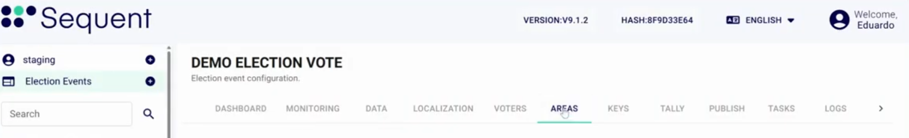

<!--
SPDX-FileCopyrightText: 2025 Sequent Tech <legal@sequentech.io>
SPDX-License-Identifier: AGPL-3.0-only
-->

import GoogleVideo from '@site/src/components/GoogleVideo';

<GoogleVideo id="1mt0vOfcXRwW0cviJMwzawJWe6hC9Mf0L" />

Las áreas le permiten organizar una elección en divisiones geográficas o lógicas concretas, como distritos o circunscripciones. Así puede asignar preguntas específicas a grupos relevantes de votantes.

## Acceder al menú de Áreas {#accessing-the-areas-menu}

Para gestionar las áreas, abra el proceso electoral y haga clic en la pestaña **Áreas**.

Desde esta pantalla puede ver las áreas existentes y las preguntas asignadas a cada una. También puede editar o eliminar un área. Solo ve las acciones que permite su rol.

## Crear un área nueva {#creating-a-new-area}

Siga estos pasos para definir un área nueva dentro de su elección:

1. Haga clic en **Añadir**. Si la lista está vacía, haga clic en **Crear un Área**.
2. **Nombre:** Escriba un nombre único para el área (por ejemplo, "Distrito 4").
3. **Descripción:** Escriba una descripción opcional.
4. **Preguntas:** Escriba tres o más letras del nombre de una pregunta y, después, seleccione la pregunta. Haga lo mismo para cada pregunta del área.

5. **Parent:** Si el área forma parte de una jerarquía mayor, puede seleccionar un área padre.
6. Si el proceso electoral usa votación ponderada por áreas, establezca el **Peso** del área.
7. **Permitir Votación Temprana:** Actívelo si los votantes del área pueden votar de forma anticipada. Solo puede cambiarlo cuando el canal de votación anticipada esté activado en **Canales de Voto Permitidos** en la pestaña **Datos** del proceso electoral.
8. Haga clic en el botón de guardar.

## Gestionar e importar áreas {#managing-and-importing-areas}

La interfaz de Áreas ofrece varias herramientas para organizar las áreas de forma eficiente y gestionar los datos en lote.

* **Buscar:** Encuentre rápidamente un área escribiendo su nombre o su descripción en la barra de búsqueda.
* **Filtros:** Use el botón de filtros para reducir la lista de áreas según criterios concretos.
* **Importar:** Haga clic en **Importar** para subir áreas en lote desde un archivo CSV sin fila de encabezado. Cada fila tiene seis columnas: el identificador del área, el código de país, el código, el nombre del área, la marca de eliminación y la política de votación anticipada. El identificador pasa a ser el **Nombre** del área y el nombre del área pasa a ser la **Descripción**. No se usan el código de país ni el código. Solo se importan las filas con `0` en la marca de eliminación. La política de votación anticipada `allow_early_voting` permite la votación anticipada en el área.
* **Insertar o actualizar áreas:** Haga clic en **Insertar o actualizar áreas** para establecer el padre de las áreas que existen. Suba un archivo CSV con fila de encabezado. La columna 1 es el **Nombre** del área y la columna 2 es el **Nombre** del área padre. Las filas de áreas que no existen se ignoran.

:::caution
Una importación vincula cada área importada a **todas** las preguntas del proceso electoral. Después de la importación, abra cada área y elimine las preguntas que no son de esa área.
:::

:::info
**Verificación de integridad:** Al importar datos de áreas, el sistema le permite pegar un **hash SHA-256** para comprobar la autenticidad del archivo y asegurarse de que no se ha modificado.
:::

1. Escriba el hash en **Verificación de Integridad (SHA 256)**. Si lo deja vacío, el portal de administración pregunta "Importar Sin Verificación de Integridad?".
2. Arrastre su archivo CSV al área de carga.
3. Haga clic en **Importar** para finalizar el proceso.
