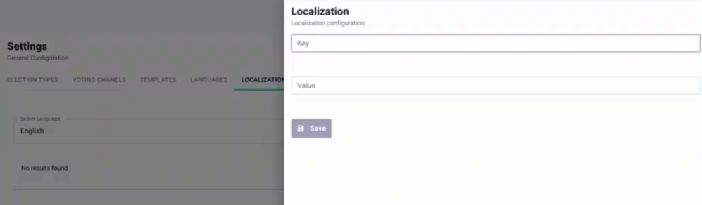
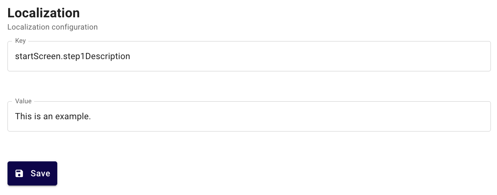

<!--
SPDX-FileCopyrightText: 2025 Sequent Tech <legal@sequentech.io>
SPDX-License-Identifier: AGPL-3.0-only
-->

import GoogleVideo from '@site/src/components/GoogleVideo';

<GoogleVideo id="1v0kyahg1n7SqxOx24lwjj4zIRGO-0YGt" />

La plataforma de Sequent permite a los administradores sobrescribir o personalizar cualquier texto que aparezca en el portal de administración o en el portal de votación. Esto se logra mediante la función **Localización**, que asigna determinadas "claves" del sistema a valores de visualización personalizados en distintos idiomas.

## Sobrescribir el texto del portal de administración {#overwriting-admin-portal-text}

Puede cambiar las etiquetas de los menús y de las pestañas del portal de administración para adaptarlas a la terminología de su organización.

1. En el menú de la izquierda, haga clic en **Configuracion** y, después, en la pestaña **LOCALIZACIÓN**.
2. En **Seleccionar idioma**, elija el idioma que desea modificar (por ejemplo, inglés).
3. Haga clic en **Añadir** para crear una nueva configuración de localización.

4. En **Ámbito del portal**, seleccione **Portal de administración** (el predeterminado) o **Global**. Escriba la **Clave** del texto que desea cambiar (por ejemplo, `electionEventScreen.tabs.dashboard`).
5. Escriba el nuevo **Valor** que desea mostrar (por ejemplo, "Estadísticas").
6. Haga clic en el botón de guardar.

## Sobrescribir el texto del portal de votación {#overwriting-voting-portal-text}

Para personalizar la experiencia de los votantes, puede modificar las instrucciones y las descripciones de la interfaz de votación.

1. Abra el proceso electoral que desea modificar. Las elecciones no tienen una pestaña **Localización**.
2. Haga clic en la pestaña **Localización**.
3. Si la pestaña muestra **Seleccionar idioma**, elija el idioma que desea modificar.
4. Haga clic en **Añadir** para sobrescribir un elemento concreto de la interfaz del votante.

5. En **Ámbito del portal**, seleccione **Portal de votación** (el predeterminado), **Verificador de papeletas**, **Portal de resultados** o **Global**. Indique la **Clave** concreta (por ejemplo, `startScreen.step1Description`) y el nuevo **Valor**.
6. Haga clic en el botón de guardar para aplicar los cambios a la experiencia del votante.

:::info
**Identificación de la clave:** Para sobrescribir un texto, debe conocer la clave del sistema asociada a ese elemento de la pantalla. Se puede modificar todo el texto de todas las pantallas una vez que se identifica la clave correspondiente.
:::
