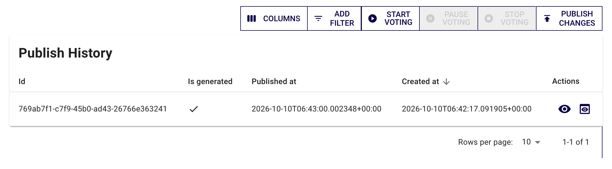
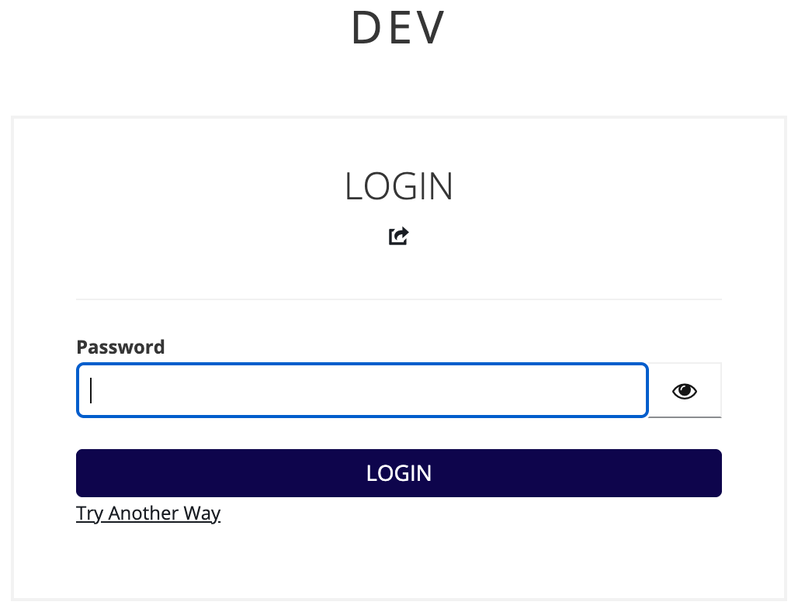
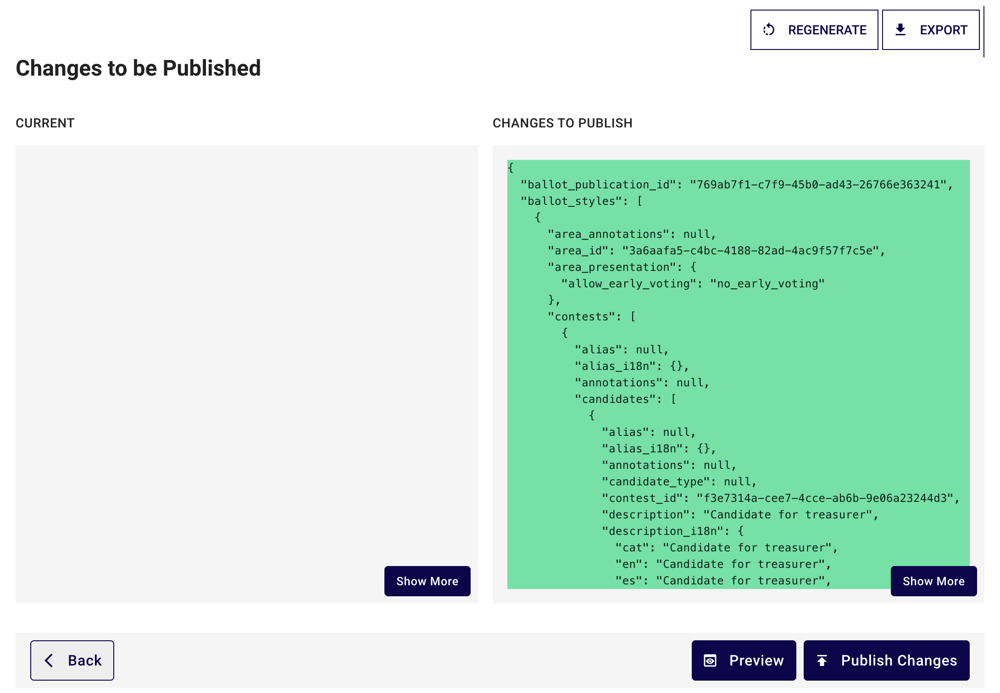
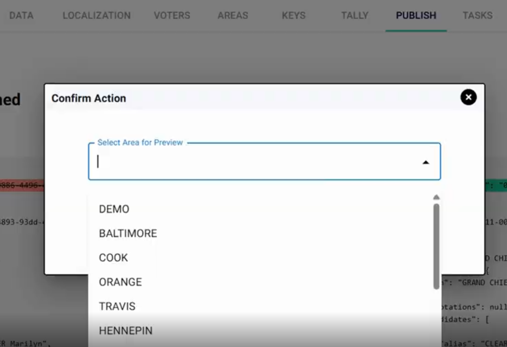

import GoogleVideo from '@site/src/components/GoogleVideo';

<!--
SPDX-FileCopyrightText: 2025 Sequent Tech <legal@sequentech.io>
SPDX-License-Identifier: AGPL-3.0-only
-->

<GoogleVideo id="1RUe2XgKsC36bZiJ8Io1iAVXYn3KDhBht" />

Cada vez que un administrador modifica datos a nivel de proceso electoral, elección, pregunta o candidato, esos cambios deben publicarse para que sean visibles en el **portal de votación**. Así se garantiza que la interfaz de votación siga siendo exacta y esté sincronizada con la última configuración administrativa.

La vía principal está en [Publicar y gestionar el período de votación](../03-procedures/05-publish.md).

## Paso 1: Abra la pestaña Publicar {#step-1-open-the-publish-tab}

1.  Abra el proceso electoral en la barra lateral.
2.  Haga clic en la pestaña **Publicar**. Cada elección también tiene su propia pestaña **Publicar**, solo para esa elección.
3.  La lista **Publication history** muestra las publicaciones anteriores. Si todavía no hay ninguna publicación, la pestaña muestra «No hay publicaciones todavía.».

## Paso 2: Genere la publicación {#step-2-generate-the-publication}

1.  Haga clic en **Generar Publicación**. Si ya existe una publicación, haga clic en **Publicar Cambios**.
2.  Haga clic en **Confirmar**. Si inició sesión hace más de 60 segundos, el portal de administración le pedirá de nuevo su contraseña. Consulte [Acciones sensibles](../00-before-you-start.md#sensitive-actions).

3.  Espere al mensaje «Papeleta generada». La página **Cambios a Publicar** compara la publicación **Actual** con los **Cambios a Publicar**.

## Paso 3: Previsualice la papeleta (opcional, pero recomendado) {#step-3-preview-the-ballot-optional-but-recommended}

1.  En la página **Cambios a Publicar**, haga clic en **Previsualizar**.
2.  En **Selecciona el área para la vista previa**, seleccione un área, ya que las papeletas pueden variar según el área.
3.  Abra la vista previa, o haga clic en **Copiar enlace** para compartirla. La vista previa muestra la papeleta del área en el **portal de votación**.

## Paso 4: Publique los cambios {#step-4-publish-the-changes}

1.  En la página **Cambios a Publicar**, haga clic en **Publicar Cambios**. No aparece ninguna ventana de confirmación.
2.  Espere al mensaje «Papeleta publicada». La lista **Publication history** muestra la nueva publicación. Los votantes ven la última publicación.

:::tip **Cuándo publicar**
Debe realizar una publicación después de:
* Corregir el nombre de un candidato o añadir una descripción.
* Añadir o quitar una pregunta en un área específica.
* Actualizar el diseño general de la papeleta o las cadenas de localización.
:::
