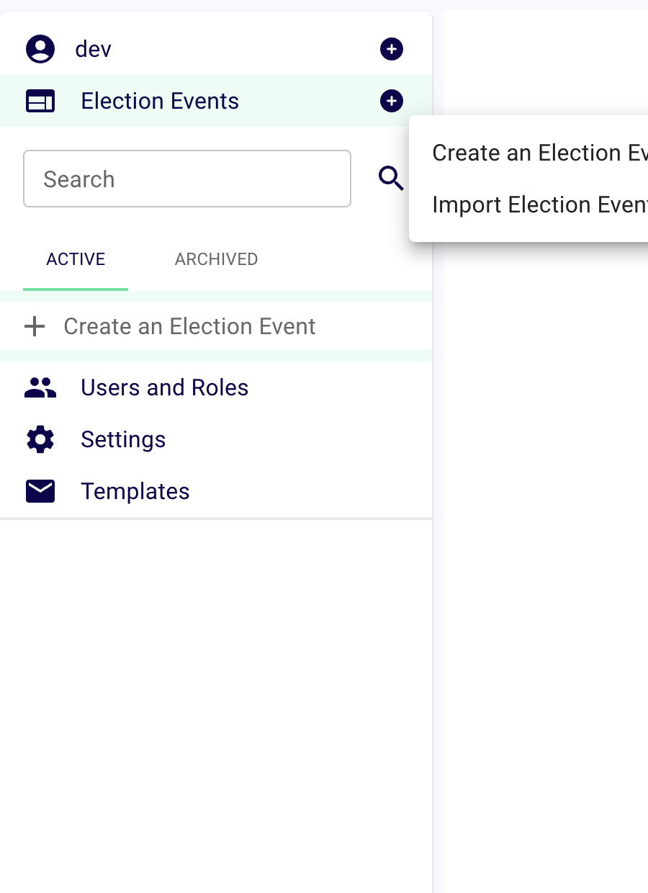
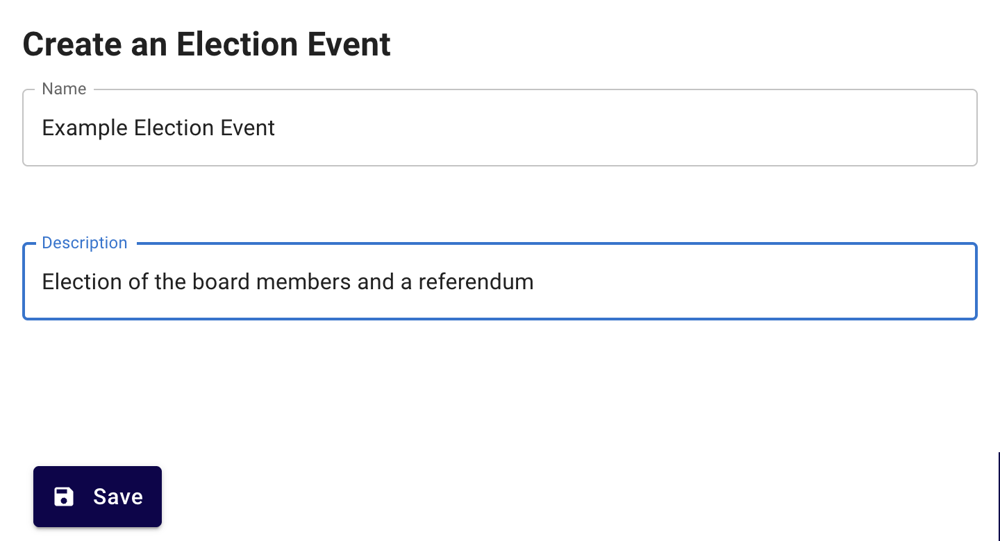
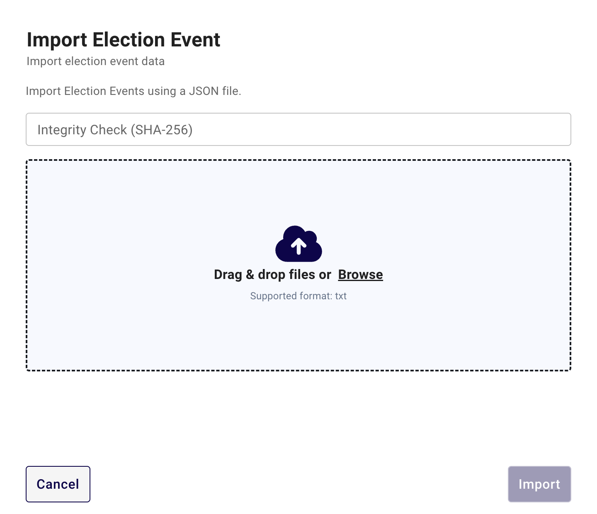
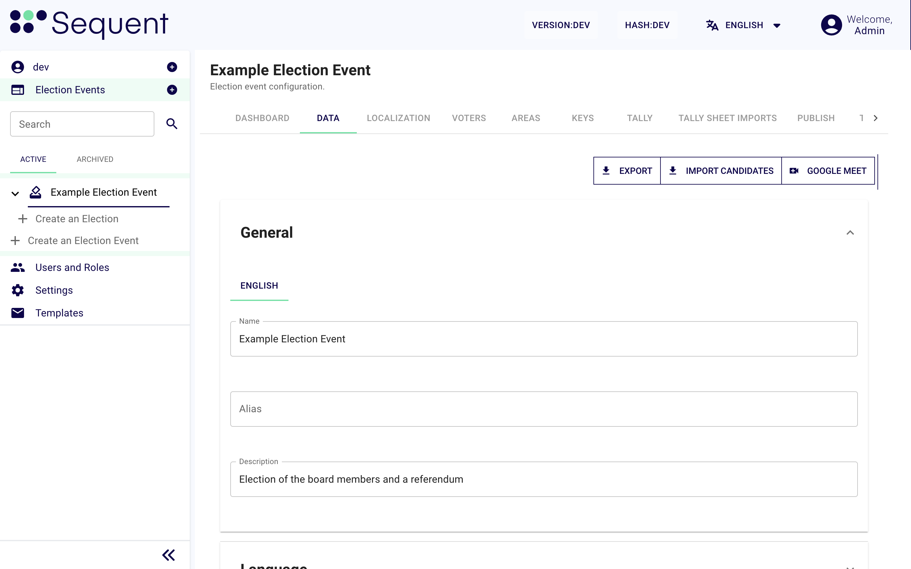
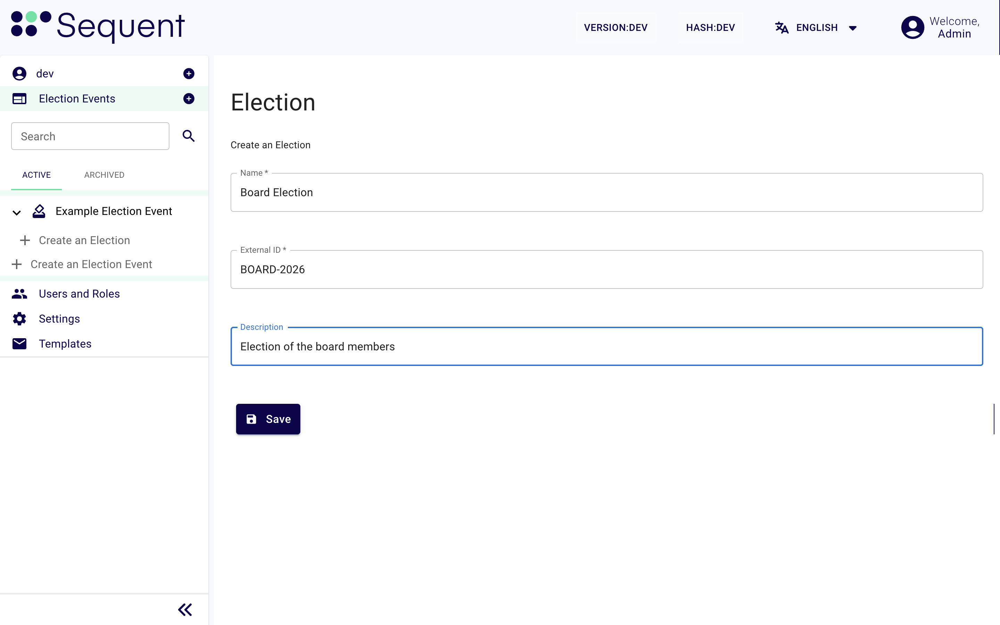
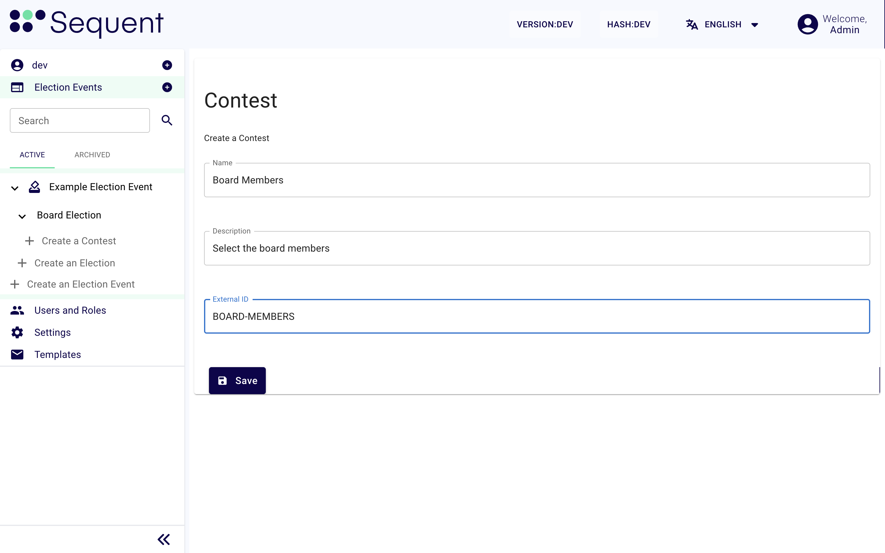
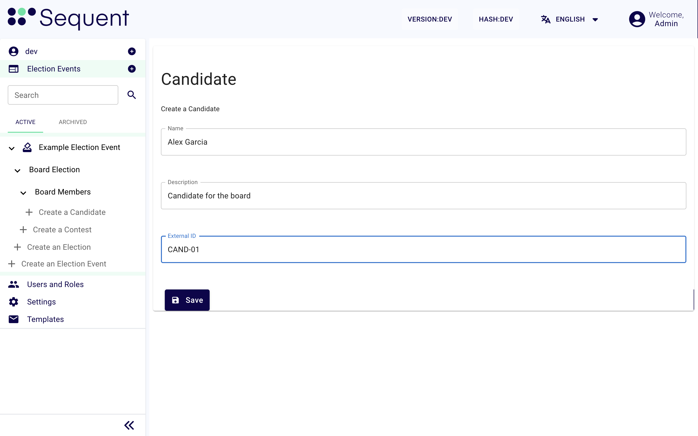
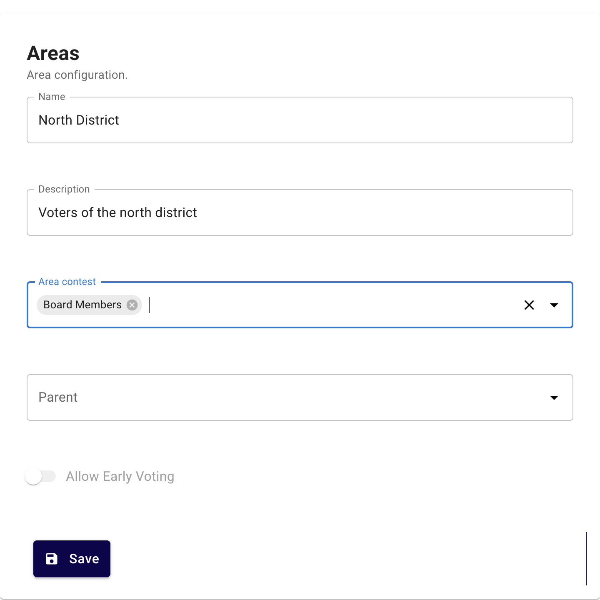
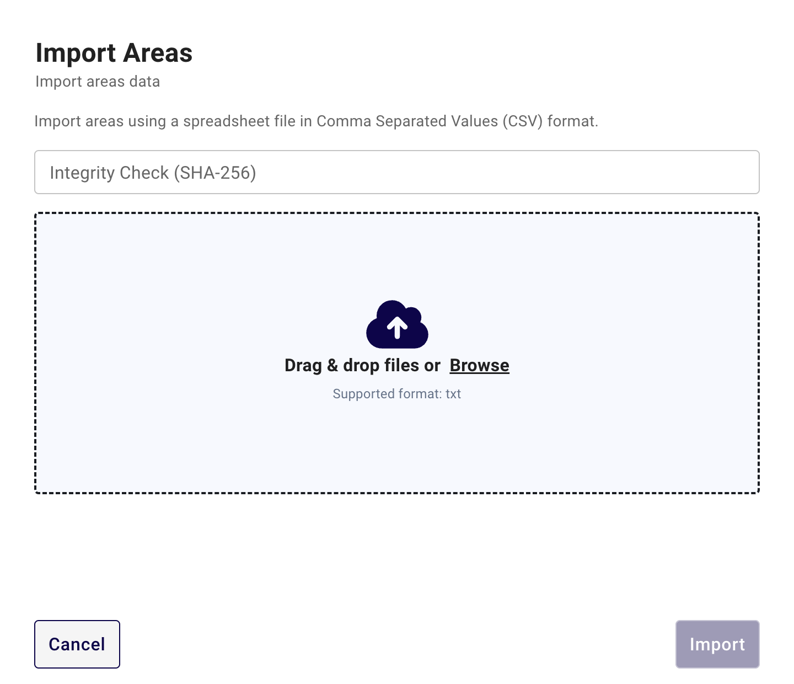

<!--
SPDX-FileCopyrightText: 2026 Sequent Tech Inc <legal@sequentech.io>
SPDX-License-Identifier: AGPL-3.0-only
-->

# Crear el proceso electoral

Este procedimiento crea el proceso electoral y su contenido: las elecciones, las preguntas, los candidatos y las áreas. Lo hace el administrador electoral. Los votantes están en el siguiente procedimiento, [Añadir los votantes](03-voters.md).

## Antes de empezar {#before-you-start}

- El inquilino está listo. Consulte [Configurar el inquilino](01-tenant.md).
- Tiene el contenido de la papeleta: las elecciones, las preguntas y los candidatos, en todos los idiomas de la elección.
- Tiene la lista de áreas y las preguntas de cada área.
- Si importa un proceso electoral: tiene el archivo y su hash SHA-256.

El orden de los pasos es importante. Cree las áreas después de las preguntas.

## 1. Crear el proceso electoral {#1-create-the-election-event}



1. En el menú de la izquierda, haga clic en el icono **+** junto a **Procesos Electorales**.
2. Haga clic en **Crear un Evento Electoral**.
3. Escriba el **Nombre** del proceso electoral.
4. Escriba la **Descripción**.
5. Haga clic en **Guardar**.



**Resultado esperado:** el panel "Tarea: Crear Evento Electoral" muestra **SUCCESS**. Aparece el mensaje "Evento Electoral creado" y el portal de administración abre el nuevo proceso electoral. El proceso electoral muestra estas pestañas. Solo ve las pestañas que permite su rol:

| Pestaña | Uso |
| --- | --- |
| **Panel de Control** | Los números del proceso electoral. |
| **Datos** | La configuración del proceso electoral. |
| **IVR** | La configuración de la votación telefónica. Solo cuando **Votación telefónica** está permitida. |
| **Localización** | Los textos del proceso electoral en cada idioma. |
| **Votantes** | La lista de votantes. |
| **Áreas** | Las áreas y sus preguntas. |
| **Claves** | La ceremonia de claves. Consulte [Realizar la ceremonia de claves](04-keys.md). |
| **Certificados** | Las autoridades de certificación para los certificados digitales de los votantes. Solo cuando el proceso electoral usa certificados de votante. |
| **Recuento** | La ceremonia de recuento y los resultados. Consulte [Realizar la ceremonia de recuento](06-tally.md). |
| **Importación de actas** | La importación de archivos de resultados de otros sistemas de votación. |
| **Publicar** | La publicación de la papeleta y el período de votación. Consulte [Publicar y gestionar el período de votación](05-publish.md). |
| **Tareas** | Las tareas en segundo plano, por ejemplo importaciones y exportaciones, con su estado. |
| **Registros** | El registro de las acciones del proceso electoral. |
| **Eventos Programados** | El inicio y el fin automáticos del período de votación. |
| **Informes** | Los informes y su programación. |
| **Aprobaciones** | Las solicitudes de los votantes que se inscriben. |

### Importar un proceso electoral (alternativo) {#import-an-election-event-alternative}

Use este método para crear un proceso electoral a partir de un archivo, por ejemplo una copia de un proceso electoral anterior.

1. En el menú de la izquierda, haga clic en el icono **+** junto a **Procesos Electorales**.
2. Haga clic en **Importar Evento Electoral**.
3. Escriba el hash del archivo en **Verificación de Integridad (SHA 256)**.
4. Arrastre el archivo al área de carga. El archivo puede ser un archivo `.json`, una exportación `.zip` o una exportación cifrada `.ezip`.
5. Si el archivo es `.ezip`, escriba la contraseña en **Contraseña de Descifrado**.
6. Haga clic en **Importar**.



**Resultado esperado:** aparece el mensaje "Election event imported Successfully".

:::caution PRECAUCIÓN
En esta versión el portal de administración no envía el hash de un archivo de proceso electoral al servidor, así que la importación no lo comprueba. Antes de importar, obtenga el hash del archivo y compárelo con el hash del nombre del archivo. Consulte [Formatos de archivo de importación](../02-reference/12-import-file-formats/01-election-event.md). Sin esta comprobación, no puede saber si alguien cambió el archivo.
:::

## 2. Configurar el proceso electoral {#2-configure-the-election-event}

1. Abra el proceso electoral.
2. Haga clic en la pestaña **Datos**.
3. En **General**, escriba el **Nombre**, el **Alias** y la **Descripción** de cada idioma.
4. En **Idioma**, seleccione los idiomas del proceso electoral. Seleccione el idioma **Por defecto**.
5. En **Canales de Voto Permitidos**, active los canales del proceso electoral: **En línea**, **Quiosco**, **Votación anticipada** o **Votación telefónica**.
6. En **Diseño de la Papeleta**, configure el logotipo y las demás opciones del portal de votación.
7. En **Password Policy**, configure las reglas de contraseña de los votantes, si los votantes usan contraseña.
8. En **Configuración Avanzada**, asegúrese de que **Estado de Confinamiento** es **No Confinado**.
9. En **Configuración Avanzada**, configure **Política de ceremonias de llaves/recuento**:
   - **Ceremonias manuales**: los fideicomisarios participan en la ceremonia de claves y en la ceremonia de recuento. Es el valor predeterminado.
   - **Permitir ceremonias automáticas**: puede hacer ceremonias sin acciones de los fideicomisarios.
10. Para publicar los resultados en el sitio web de resultados, configure **Results Website** en **Habilitado**. Después configure **Results Website Access** y **Results Website Visibility**.
11. Haga clic en **Guardar**.



**Resultado esperado:** el portal de administración guarda los datos. El menú muestra el nuevo nombre.

:::note NOTA
**Confinado** oculta la mayoría de las pestañas del proceso electoral, incluida **Aprobaciones**, y detiene todas las publicaciones. Úselo solo cuando deba congelar el proceso electoral.
:::

:::danger ADVERTENCIA
En una ceremonia automática, ninguna persona guarda un fragmento de clave. La plataforma puede descifrar los votos sin los fideicomisarios. Use las ceremonias automáticas solo para pruebas y para elecciones en las que sus reglas lo permitan.
:::

## 3. Crear las elecciones {#3-create-the-elections}

Haga estos pasos para cada elección.

1. En el menú de la izquierda, haga clic en la flecha junto al proceso electoral para mostrar sus elecciones.
2. Debajo de las elecciones, haga clic en **Crear una Elección**.
3. Escriba el **Nombre**.
4. Escriba el **ID externo**. Es el identificador de la elección en sus otros sistemas.
5. Escriba la **Descripción**.
6. Haga clic en **Guardar**.
7. Haga clic en la pestaña **Datos** de la nueva elección.
8. En **General**, escriba el nombre y la descripción de cada idioma.
9. En **Canales de Voto Permitidos**, seleccione los canales de votación de esta elección.
10. En **Configuración Avanzada**, configure **Inicializar Política de Reportes**. Seleccione **Requerido** si debe hacer un informe de inicialización antes de que se abra el período de votación.
11. En **Configuración Avanzada**, configure **Permitir Recuento**. La tabla indica los valores.
12. Haga clic en **Guardar**.

| Valor de **Permitir Recuento** | Significado |
| --- | --- |
| **Permitido** | Puede iniciar el recuento en cualquier momento. |
| **No permitido** | No puede iniciar el recuento. |
| **Permitir cuando termine el periodo de votación** | Puede iniciar el recuento solo cuando todos los canales de votación están cerrados. |



**Resultado esperado:** la elección aparece debajo del proceso electoral en el menú. La elección tiene estas pestañas: **Panel de Control**, **Datos**, **Votantes**, **Publicar**, **Aprobaciones** y **Hojas de Recuento**.

:::note NOTA
No puede cambiar el **ID externo** después de guardarlo.
:::

## 4. Crear las preguntas {#4-create-the-contests}

Haga estos pasos para cada pregunta.

1. En el menú de la izquierda, haga clic en la flecha junto a la elección para mostrar sus preguntas.
2. Debajo de las preguntas, haga clic en **Crear un Concurso**.
3. Escriba el **Nombre**, la **Descripción** y el **ID externo**.
4. Haga clic en **Guardar**.
5. Haga clic en la pestaña **Datos** de la nueva pregunta.
6. En **Sistema de votación de papeletas**, seleccione el **Algoritmo de conteo**:
   - **Mayoría Plural**: el votante selecciona candidatos. Ganan los candidatos con más votos.
   - **Segunda Vuelta Instantánea**: el votante ordena los candidatos. Después seleccione la **Política de desempate**: **Aleatorias** o **Procedimiento externo**.
7. En **Diseño de la Papeleta**, configure el número de votos:
   - El número mínimo de selecciones. Escriba `0` si el votante puede dejar la pregunta en blanco.
   - El número máximo de selecciones. En **Segunda Vuelta Instantánea**, es el rango más bajo que puede dar un votante.
   - El número de candidatos ganadores.
8. En **Diseño de la Papeleta**, en **Políticas**, configure lo que hace el portal de votación cuando el votante selecciona muy pocos candidatos, demasiados o ninguno. Para **Segunda Vuelta Instantánea**, configure también las políticas para los rangos duplicados y los rangos omitidos.
9. Haga clic en **Guardar**.



**Resultado esperado:** la pregunta aparece debajo de la elección en el menú.

:::caution PRECAUCIÓN
El portal de administración no comprueba que el mínimo sea menor que el máximo. Compruebe los valores antes de guardar. Asegúrese de que el máximo no sea mayor que el número de candidatos.
:::

## 5. Crear los candidatos {#5-create-the-candidates}

Haga estos pasos para cada candidato.

1. En el menú de la izquierda, haga clic en la flecha junto a la pregunta para mostrar sus candidatos.
2. Debajo de los candidatos, haga clic en **Crear un Candidato**.
3. Escriba el **Nombre**, la **Descripción** y el **ID externo**.
4. Haga clic en **Guardar**.
5. Haga clic en la pestaña **Datos** del nuevo candidato.
6. En **General**, escriba el nombre y la descripción de cada idioma.
7. En **Imagen**, añada una foto o un logotipo si es necesario.
8. Haga clic en **Guardar**.



**Resultado esperado:** el candidato aparece debajo de la pregunta en el menú.

## 6. Crear las áreas {#6-create-the-areas}

Un área indica qué preguntas ven sus votantes. Cada votante pertenece a un área.

1. Abra el proceso electoral.
2. Haga clic en la pestaña **Áreas**.
3. Haga clic en **Crear Área**. Si la lista ya tiene áreas, haga clic en **Añadir**.
4. Escriba el **Nombre** y la **Descripción**.
5. En **Pregunta del área**, escriba parte del nombre de una pregunta y seleccione la pregunta. Haga esto para cada pregunta del área.
6. Si el área forma parte de un área mayor, seleccione el área padre.
7. Si los votantes del área pueden votar de forma anticipada, active **Permitir Votación Temprana**. Esta opción solo está disponible si **Votación anticipada** está activa en los canales de voto del proceso electoral.
8. Haga clic en **Guardar**.



**Resultado esperado:** aparece el mensaje "Área creada". El área aparece en la lista.

### Importar áreas (alternativo) {#import-areas-alternative}

1. Cree un archivo CSV sin fila de encabezado. Cada fila tiene seis columnas, en este orden:

   | Columna | Valor |
   | --- | --- |
   | 1 | El **Nombre** del área. |
   | 2 | No se usa. Déjela vacía. |
   | 3 | No se usa. Déjela vacía. |
   | 4 | La **Descripción** del área. |
   | 5 | Marca de eliminación. Escriba `0` para importar la fila. Las filas con otro valor no se importan. |
   | 6 | Política de votación anticipada: `allow_early_voting` o `no_early_voting`. Un valor vacío u otro valor da `no_early_voting`. |

   Ejemplo:

   ```csv
   North,,,North District,0,no_early_voting
   South,,,South District,0,allow_early_voting
   ```

2. En la pestaña **Áreas**, haga clic en **Importar**.
3. Escriba el hash del archivo en **Verificación de Integridad (SHA 256)**.
4. Suba el archivo CSV. Después haga clic en **Importar**.



:::caution PRECAUCIÓN
Una importación vincula cada área importada con **todas** las preguntas del proceso electoral. Después de la importación, abra cada área y elimine las preguntas que no son de esa área.
:::

## Si hay un problema {#if-there-is-a-problem}

| Problema | Acción |
| --- | --- |
| El icono **+** junto a **Procesos Electorales** no aparece. | Su cuenta no tiene el permiso para crear procesos electorales. Pregunte al administrador del inquilino. |
| La tarea de importación falla con "Failed to verify the integrity: …". Mire la pestaña **Tareas**. | El hash del archivo no es el hash que escribió. El archivo no es el que espera, o escribió mal el hash. Vuelva a obtener el archivo de su origen. No lo importe sin la comprobación. |
| Un idioma no está disponible en **Idioma**. | Active el idioma en **Configuración** > **LANGUAGES**. Consulte [Configurar el inquilino](01-tenant.md). |
| Una pregunta no está en la lista de **Pregunta del área**. | Asegúrese de que creó la pregunta. Escriba parte del nombre de la pregunta. |

## Más información {#more-information}

- [Crear un proceso electoral (con vídeo)](../01-tutorials/02-admin_portal_tutorials_create-election.md)
- [Importar un proceso electoral](../01-tutorials/04-admin_portal_tutorials_import-elections.md)
- [Archivar un proceso electoral](../01-tutorials/03-admin_portal_tutorials_archive-elections.md)
- [Crear preguntas y candidatos](../01-tutorials/05-admin_portal_tutorials_contests-candidates.md)
- [Definir las áreas](../01-tutorials/06-admin_portal_tutorials_define-areas.md)
- [Traducir el proceso electoral](../01-tutorials/09-admin_portal_tutorials_election-localization.md)
- [Proceso electoral: Datos](../02-reference/02-election-event/03-election_management_election-event_data.md)
- [Elección: Datos](../02-reference/03-election/03-election_management_election_data.md)
- [Pregunta: Datos](../02-reference/04-contest/01-election_management_contest_data.md)
- [Candidato: Datos](../02-reference/05-candidate/01-election_management_candidate_data.md)
- [Áreas](../02-reference/02-election-event/06-election_management_election-event_areas.md)

**Siguiente:** [Añadir los votantes](03-voters.md).
