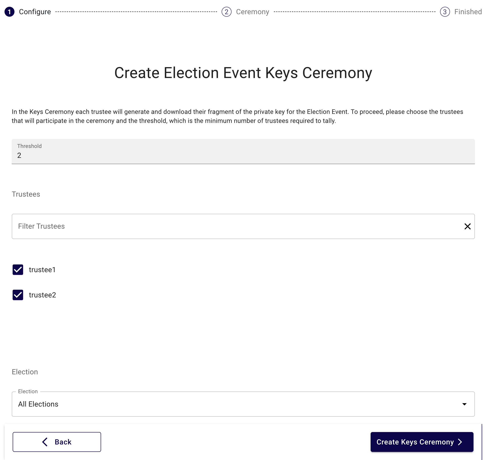
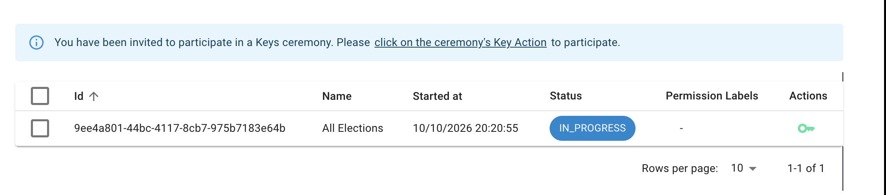
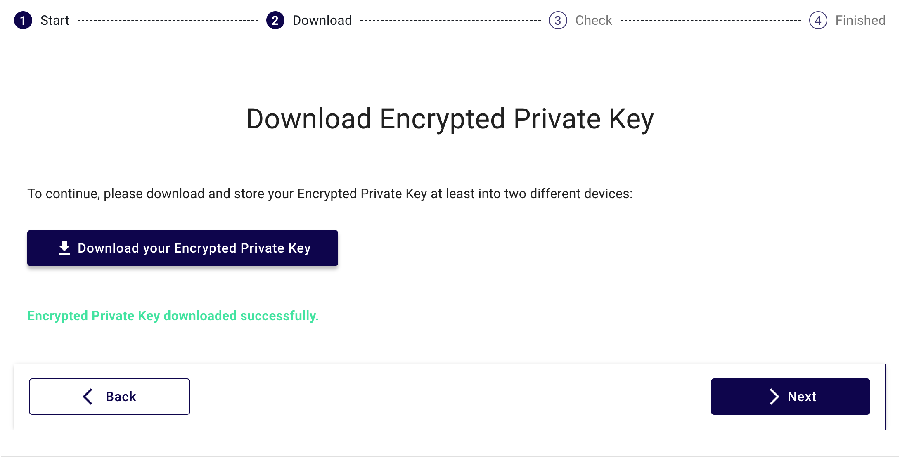
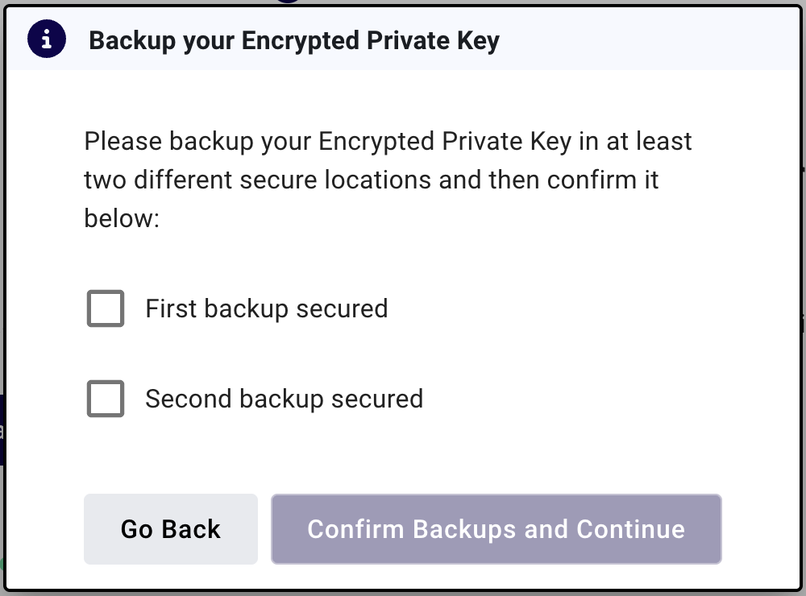
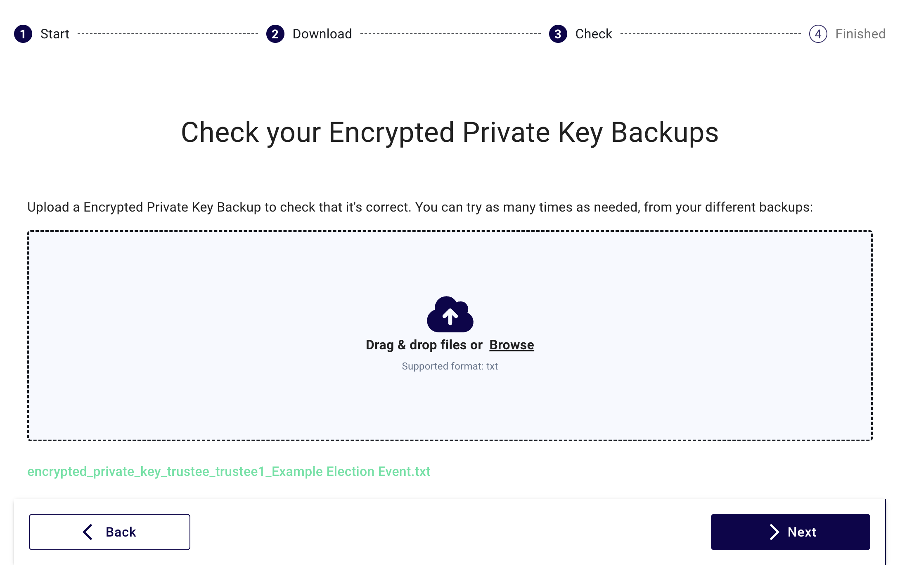
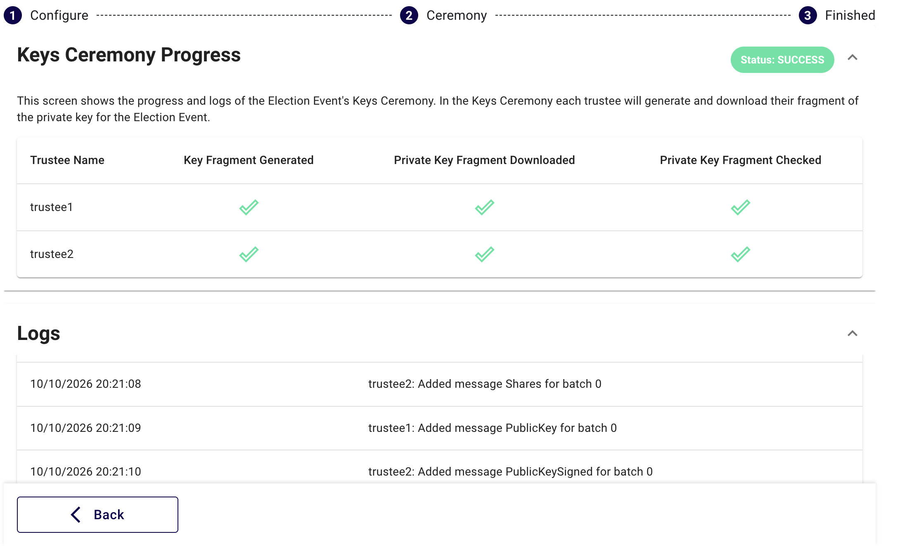

<!--
SPDX-FileCopyrightText: 2026 Sequent Tech Inc <legal@sequentech.io>
SPDX-License-Identifier: AGPL-3.0-only
-->

# Realizar la ceremonia de claves

La ceremonia de claves crea las claves de la elección. El portal de votación cifra cada papeleta con la clave pública. La clave privada está en fragmentos: cada fideicomisario guarda un fragmento. Para descifrar los votos, un número mínimo de fideicomisarios (el umbral) debe aportar su fragmento en la ceremonia de recuento.

El administrador electoral inicia la ceremonia. Después, cada fideicomisario descarga, guarda y comprueba su fragmento de clave.

## Antes de empezar {#before-you-start}

- Todas las elecciones del proceso electoral existen. Consulte [Crear el proceso electoral](02-event.md).
- Cada fideicomisario tiene una cuenta con el rol `trustee` y el valor correcto en **Actuar como fideicomisario**. Consulte [Configurar el inquilino](01-tenant.md).
- Usted conoce el umbral. Debe ser 2 o más, y no más que el número de fideicomisarios.
- Cada fideicomisario tiene dos dispositivos de almacenamiento para las copias de seguridad, por ejemplo dos memorias USB.
- Usted ha acordado una fecha y una hora con los fideicomisarios. Todos los fideicomisarios deben hacer su parte.

:::danger ADVERTENCIA
No puede cancelar ni reiniciar una ceremonia de claves desde el portal de administración. Compruebe el umbral, los fideicomisarios y la elección antes de confirmar. Si debe cambiar una ceremonia de claves, contacte con el soporte de Sequent.
:::

:::caution PRECAUCIÓN
Una ceremonia de claves para **Todas las Elecciones** le impide crear otras ceremonias de claves en el proceso electoral. Cree todas las elecciones antes de iniciarla. Si añade una elección más tarde, esa elección no puede obtener claves.
:::

## 1. Crear la ceremonia de claves (administrador electoral) {#1-create-the-key-ceremony-election-administrator}

1. Abra el proceso electoral.
2. Haga clic en la pestaña **Claves**.
3. Haga clic en **Crear Ceremonia de Claves**. Si el proceso electoral ya tiene una ceremonia de claves, haga clic en **Añadir**.
4. En **Umbral**, escriba el umbral.
5. En **Autoridades**, seleccione los fideicomisarios de la ceremonia. Seleccione un número de fideicomisarios igual o mayor que el umbral.
6. Si el proceso electoral permite ceremonias automáticas, decida sobre **Ceremonia automática**. Déjela desactivada en una elección con fideicomisarios. Consulte la advertencia en [Crear el proceso electoral](02-event.md#2-configure-the-election-event).
7. En **Elección**, seleccione una elección. Para crear una clave para todas las elecciones, deje el valor predeterminado, **Todas las Elecciones**.
8. Haga clic en **Crear Ceremonia de Claves**.
9. Lea el mensaje "¿Estás seguro de que quieres Crear una Ceremonia de Claves?".
10. Haga clic en **Sí, Crear Ceremonia de Claves**.

**Resultado esperado:** aparece el mensaje "Ceremonia de Claves creada". Se abre la página **Progreso de Ceremonia de Claves** con el estado `STARTED`. El estado cambia a `IN_PROGRESS` cuando los servicios de los fideicomisarios están listos.

11. Avise a los fideicomisarios de que la ceremonia de claves ha empezado. En una ceremonia automática, los fideicomisarios no hacen nada. Vaya al [paso 3](#3-check-that-the-ceremony-is-complete-election-administrator).

## 2. Guardar el fragmento de clave (cada fideicomisario) {#2-save-the-key-fragment-each-trustee}

Cada fideicomisario hace estos pasos en su propio ordenador, con su propia cuenta.

1. Inicie sesión en el portal de administración.
2. Abra el proceso electoral.
3. Haga clic en la pestaña **Claves**. Aparece el mensaje "Ha sido invitado a participar a una Ceremonia de Claves."
4. En la fila de la ceremonia, haga clic en el icono de llave **Participar en la ceremonia de claves** de la columna **Acciones**.
5. Lea la página **Ceremonia de Claves de Autoridad**. Asegúrese de que el nombre de fideicomisario de la página es su fideicomisario.
6. Haga clic en **Siguiente**.

Si aparece el mensaje "Esperando a la Generación de Claves..", los servicios de los fideicomisarios todavía no han creado las claves. Espere uno o dos minutos. **Siguiente** pasa a estar disponible.

7. Haga clic en **Descargar tu Clave Privada Encriptada**. El navegador guarda un archivo con el nombre `encrypted_private_key_trustee_<user>_<election>.txt`.
8. Copie el archivo en su primer dispositivo de almacenamiento.
9. Copie el archivo en su segundo dispositivo de almacenamiento.
10. Haga clic en **Siguiente**. Se abre la ventana **Copia de seguridad de tu Clave Privada Encriptada**.
11. Seleccione **Primera copia de seguridad realizada**.
12. Seleccione **Segunda copia de seguridad realizada**.
13. Haga clic en **Confirmar copias de seguridad y Continuar**.
14. Arrastre el archivo de uno de los dispositivos de almacenamiento al área de carga de la página **Verifica tus Copias de Seguridad de tu Clave Privada Encriptada**.
15. Asegúrese de que aparece el mensaje "Copia de seguridad verificada correctamente."
16. Haga clic en **Siguiente**.
17. Borre del ordenador el archivo descargado. Guarde solo las dos copias de los dispositivos de almacenamiento.
18. Guarde los dos dispositivos de almacenamiento en dos lugares seguros diferentes.

:::danger ADVERTENCIA
No dé su fragmento de clave a otra persona, y no lo envíe por correo electrónico ni por chat. Guárdelo hasta el final de la ceremonia de recuento y el final del período de reclamaciones. Si demasiados fideicomisarios pierden su fragmento, nadie puede descifrar los votos.
:::

**Resultado esperado:** el paso **Finalizado** muestra el progreso de la ceremonia.

### Comprobar una copia de seguridad de nuevo (opcional) {#check-a-backup-again-optional}

Puede comprobar una copia de seguridad más tarde, por ejemplo antes de la ceremonia de recuento. Hágalo mientras el estado de la ceremonia es `IN_PROGRESS` o `SUCCESS`.

1. En la pestaña **Claves**, abra la ceremonia.
2. Haga clic en **Verificar clave**.
3. Arrastre el archivo de un dispositivo de almacenamiento al área de carga.
4. Asegúrese de que aparece el mensaje "Copia de seguridad verificada correctamente."

## 3. Comprobar que la ceremonia está completa (administrador electoral) {#3-check-that-the-ceremony-is-complete-election-administrator}

1. Abra el proceso electoral.
2. Haga clic en la pestaña **Claves**.
3. Haga clic en el icono de ver de la ceremonia. Se abre la página **Progreso de Ceremonia de Claves**.
4. Asegúrese de que cada fideicomisario tiene una marca en estas columnas:
   - **Fragmento de Clave Generado**
   - **Fragmento Privado de Clave Descargado**
   - **Fragmento Privado de Clave Comprobado**

**Resultado esperado:** el estado es `SUCCESS`. El estado cambia a `SUCCESS` solo cuando todos los fideicomisarios han comprobado su fragmento de clave. Una ceremonia automática cambia a `SUCCESS` cuando existe la clave pública.

4. Registre la fecha, la hora, los fideicomisarios presentes y el resultado de la ceremonia.

## Estado de la ceremonia {#ceremony-status}

| Estado | Significado |
| --- | --- |
| `STARTED` | La ceremonia está creada. |
| `IN_PROGRESS` | Los fideicomisarios pueden descargar y comprobar su fragmento de clave. |
| `SUCCESS` | Todos los fideicomisarios han comprobado su fragmento de clave. La ceremonia está completa. |
| `CANCELLED` | La ceremonia está cancelada. |

## Si hay un problema {#if-there-is-a-problem}

| Problema | Acción |
| --- | --- |
| "Seleccionaste un umbral de ... pero debe estar entre ... y ..." | Escriba un umbral entre 2 y el número de fideicomisarios. |
| "Seleccionaste sólo ... autoridades, pero debe seleccionar al menos ..." | Seleccione más fideicomisarios, o escriba un umbral más bajo. |
| La pestaña **Claves** no está para un fideicomisario. | La cuenta no tiene el rol `trustee`. Pregunte al administrador del inquilino. |
| El fideicomisario no ve el icono de llave. | Asegúrese de que **Actuar como fideicomisario** de la cuenta es el fideicomisario de la ceremonia. |
| "Copa de Seguridad de la Clave Encriptada Privada inválida, por favor inténtalo de nuevo" | Use el archivo del otro dispositivo de almacenamiento. Si los dos fallan, haga clic en **Atrás** y descargue el archivo de nuevo. |
| "La descarga de la clave privada ya no está disponible porque la ceremonia ha avanzado." | No puede descargar el archivo de nuevo. Use sus copias de seguridad. |
| "there's already an existing running ceremony ..." (ya existe una ceremonia en curso) | El proceso electoral, o todas las elecciones, ya tienen una ceremonia de claves. Contacte con el soporte de Sequent si debe reemplazarla. |
| El estado se queda en `IN_PROGRESS`. | Un fideicomisario no ha comprobado su fragmento de clave. Mire la tabla de fideicomisarios y contacte con ese fideicomisario. |

## Más información {#more-information}

- [Ceremonia de claves (con capturas de pantalla)](../01-tutorials/10-admin_portal_tutorials_key-ceremony.md)
- [Proceso electoral: Claves](../02-reference/02-election-event/07-election_management_election-event_keys.md)
- [Configuración: Fideicomisarios](../02-reference/user-manual/settings/settings_trustees.md)

**Siguiente:** [Publicar y gestionar el período de votación](05-publish.md).
