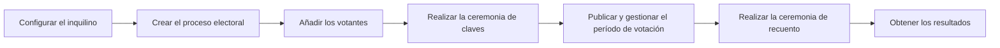

<!--
SPDX-FileCopyrightText: 2026 Sequent Tech Inc <legal@sequentech.io>
SPDX-License-Identifier: AGPL-3.0-only
-->

# Antes de empezar

Lea esta página antes de hacer un procedimiento. Da el orden del trabajo, los roles, los términos
y las reglas que mantienen la seguridad de la elección.

## El orden del trabajo {#the-order-of-the-work}

Haga los procedimientos en este orden. Puede cambiar el contenido de la papeleta después de la
ceremonia de claves, pero debe publicar de nuevo después de cada cambio.

## Roles {#roles}

| Rol | Tareas | Rol predeterminado en el portal de administración |
| --- | --- | --- |
| Sequent | Crea el inquilino. Instala los servicios de los fideicomisarios. Le da la primera cuenta de administrador y la dirección del portal de administración. | - |
| Administrador del inquilino | Configura el inquilino. Crea las cuentas de los otros usuarios. | `admin` |
| Administrador electoral | Crea y configura el proceso electoral. Inicia las ceremonias. Publica la papeleta. Abre y cierra el período de votación. Obtiene los resultados. | `admin` |
| Fideicomisario | Guarda un fragmento de la clave privada de la elección. Participa en la ceremonia de claves y en la ceremonia de recuento. | `trustee` |

Una persona puede tener más de un rol. Un fideicomisario no debe ser la única persona que controla
a los otros fideicomisarios.

:::note
Su organización puede cambiar los roles predeterminados. Si un botón o una pestaña de este manual no
está en su pantalla, su cuenta no tiene el permiso necesario. Pregunte al administrador del
inquilino.
:::

## Términos {#terms}

| Término | Significado |
| --- | --- |
| Inquilino | El espacio de su organización en la plataforma. Contiene su configuración, sus usuarios y sus procesos electorales. |
| Proceso electoral | El proceso completo de la elección, desde la configuración hasta los resultados. Contiene una o más elecciones. |
| Elección | Una votación dentro de un proceso electoral. Contiene una o más preguntas. |
| Pregunta | Una pregunta o una contienda de la papeleta. Contiene los candidatos. |
| Candidato | Una opción que un votante puede seleccionar en una pregunta. |
| Área | Un grupo de votantes, por ejemplo un distrito. Un área indica qué preguntas ve un votante. |
| Votante | Una persona que puede votar en el proceso electoral. Cada votante pertenece a un área. |
| Fideicomisario | Una persona que guarda un fragmento de la clave privada de la elección. |
| Umbral | El número mínimo de fideicomisarios que deben participar en la ceremonia de recuento. |
| Ceremonia de claves | El procedimiento que crea las claves de la elección. Los votantes cifran sus papeletas con la clave pública. |
| Fragmento de clave | La parte de la clave privada que guarda un fideicomisario. En el portal de administración es el archivo **Clave Privada Encriptada**. |
| Publicación | Una versión de la papeleta que el portal de votación muestra a los votantes. |
| Canal de votación | Una forma de votar: **En línea** (portal de votación) o **Kiosco** (quiosco de votación). |
| Ceremonia de recuento | El procedimiento que descifra y cuenta los votos. |
| Acción sensible | Una acción para la que el portal de administración le pide de nuevo su contraseña. |

## Lo que necesita {#what-you-need}

- Un ordenador con una versión actualizada de Chrome, Firefox, Edge o Safari.
- La dirección del portal de administración. Sequent se la da.
- Su nombre de usuario y su contraseña. El administrador del inquilino se los da.
- Para los fideicomisarios: dos dispositivos de almacenamiento para las copias de seguridad del
  fragmento de clave, por ejemplo dos memorias USB. Use dispositivos que solo usted controla.

## Iniciar sesión en el portal de administración {#sign-in-to-the-admin-portal}

1. Abra la dirección del portal de administración en el navegador.
2. Escriba su nombre de usuario y su contraseña.
3. Haga clic en el botón para iniciar sesión.
4. Si el portal de administración le pide un segundo factor, haga los pasos de la pantalla.

**Resultado esperado:** el portal de administración se abre. El menú de la izquierda muestra su
inquilino y los elementos que su rol permite:

| Elemento del menú | Uso |
| --- | --- |
| Nombre del inquilino, con un icono **+** | Muestra su inquilino. Solo Sequent puede usar el icono **+**. |
| **Procesos Electorales** | La lista de procesos electorales. Haga clic en **+** para crear o importar un proceso electoral. Use **Activos** y **Archivados** para filtrar la lista. |
| **Usuarios y Roles** | Las cuentas de los administradores y de los fideicomisarios, y los roles. |
| **Configuracion** | La configuración del inquilino. |
| **Plantillas** | Las plantillas de los mensajes y de los documentos. |
| **Ayuda** | Enlaces de ayuda. Este elemento solo aparece si su inquilino tiene enlaces de ayuda. |

Debajo de cada proceso electoral, el menú muestra un árbol: proceso electoral, elecciones,
preguntas y candidatos. Haga clic en los tres puntos junto a un elemento para ver sus acciones.

### Si olvida su contraseña {#if-you-forget-your-password}

1. Si la página de inicio de sesión muestra un enlace para restablecer la contraseña, haga clic en él.
2. Escriba la dirección de correo electrónico de su cuenta y envíe el formulario.
3. Abra el correo electrónico que recibe y siga los pasos que indica.

Si la página de inicio de sesión no tiene un enlace para restablecer la contraseña, consulte al
administrador del inquilino. El administrador del inquilino define una contraseña nueva con
**Cambiar contraseña** en la lista de usuarios. Consulte [Usuarios](Reference/User-Manual/Users-and-Roles/Users/admin_portal_reference_user-manual_users-and-roles_users.md).

## Acciones sensibles {#sensitive-actions}

Algunas acciones necesitan una confirmación reciente de su identidad, por ejemplo publicar la
papeleta o abrir el período de votación. Cuando hace una de estas acciones, el portal de
administración muestra: "La acción que estás a punto de realizar es sensible y requiere
confirmación."

1. Haga clic en **Confirmar**.
2. Escriba su contraseña en la página de inicio de sesión.

**Resultado esperado:** el portal de administración se abre de nuevo y continúa la acción.

## Reglas de seguridad {#safety-rules}

:::danger ADVERTENCIA
Mantenga los fragmentos de clave en secreto y en un lugar seguro. Si en la ceremonia de recuento
tienen su fragmento de clave menos fideicomisarios que el umbral, nadie puede descifrar los votos.
Nadie, tampoco Sequent, puede crear de nuevo un fragmento de clave.
:::

- Cada fideicomisario guarda su propio fragmento de clave. No envíe un fragmento de clave por
  correo electrónico ni por chat.
- No dé su contraseña a otra persona. Cada persona usa su propia cuenta.
- Haga los procedimientos desde un ordenador y una red de confianza.
- Registre la fecha, la hora y las personas presentes en cada ceremonia. El portal de
  administración también registra las acciones en la pestaña **Logs** del proceso electoral.

## Convenciones de este manual {#conventions-in-this-manual}

| Convención | Significado |
| --- | --- |
| **Negrita** | Un texto de la pantalla: un botón, una pestaña, un campo o un elemento del menú. El texto es el mismo que en la pantalla. |
| **Procesos Electorales** > **Datos** | Vaya al primer elemento y después al segundo. |
| Resultado esperado | Lo que ve cuando el paso es correcto. |
| ADVERTENCIA | Un riesgo para el secreto, la integridad o la disponibilidad de la elección. |
| PRECAUCIÓN | Un riesgo de pérdida de datos, o una acción que no puede deshacer. |

**Siguiente:** [Configurar el inquilino](procedures/01-tenant.md).
